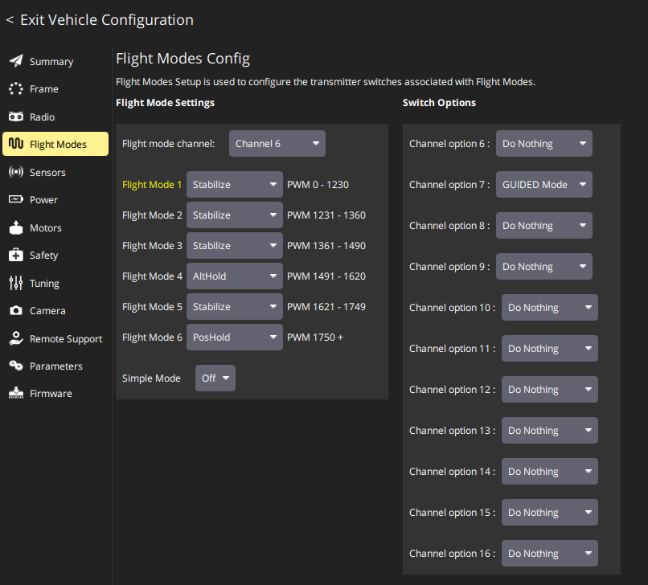

# Ardupilot setup on Kakute-H7 drone (most likely a Robofly)

Follow this guide to setup a new drone with the Ardupilot autopilot for the ROS2 version of the MRS UAV system.
Generally, the configuration is the same as for Pixhawk, and the differences are summarized here.
Download the [MRS Ardupilot API package](git@mrs.fel.cvut.cz:nekovfra/mrs_uav_ardupilot_api.git) for supporting materials.

## SD card setup

Unlike the PX4, ardupilot SD card setup requires the serial stream configuration files ('message-intervals-chan0.txt' and 'message-intervals-chan1.txt' from 'mrs_uav_ardupilot_api/real_hw_setup_material') to be placed in the card's root directory.
The Ardupilot convention is that the numbering of the '.txt' file reflects the numbering of serial ports configured for Mavlink protocol.
In our case for example, the serial0, which we access using the QGroundControl, will be configured with 'message-intervals-chan0.txt' file, and serial4 with 'message-intervals-chan1.txt' file, as the serial1-3 are not configured for Mavlink.

## SW setup

- Download [QGroundControl](http://qgroundcontrol.com/)
- Connect the Kakute to your computer with a USB cable and run QGroundControl
- Set the airframe
- Calibrate all the sensors according to the instructions in QGroundControl
- Upload the tested Ardupilot parameters ('mrs_uav_ardupilot_api/real_hw_setup_material/ardupilot_robofly.params')
- Use following configuration to setup the flight modes:

Main difference here is that Ardupilot utilizes "GUIDED" mode instead of "OFFBOARD" mode.

