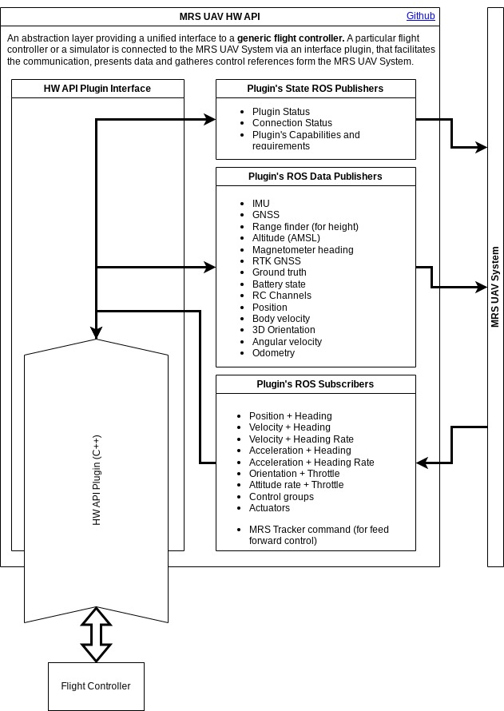

:::warning
This page is describing the upcoming ROS2 version of the MRS UAV System (however, it may be still outdated). If you are looking for ROS1 version of the docs, follow to https://ctu-mrs.github.io/docs/1.5.0/introduction/.
:::

# The MRS Hardware API interface

The HW API provides an abstraction layer between the [MRS UAV System](https://github.com/ctu-mrs/mrs_uav_system) and a UAV flight controller.
On one side, the HW API provides a unified ROS interfaces for the [core](https://github.com/ctu-mrs/mrs_uav_core) as if it was a **generic flight controller**.
On the other side, the communication with a particular hardware (or simulator) can be orchestrated using whatever is required.
The HW API is defined by the package [mrs_uav_hw_api](https://github.com/ctu-mrs/mrs_uav_hw_api/), which is part of the [mrs_uav_core](https://github.com/ctu-mrs/mrs_uav_core).



## Doxygen documentation for the C++ API

<Button label="🔗 mrs_uav_hw_api C++ API" link="https://ctu-mrs.github.io/mrs_uav_hw_api/" block /><br />

### Control output from the MRS UAV System

The control output can be any of the following:

* 3D **Position** + **Heading**
* 3D body-frame **Velocity** + **Heading**
* 3D body-frame **Velocity** + **Heading rate**
* 3D body-frame **Acceleration** + **Heading**
* 3D body-frame **Acceleration** + **Heading rate**
* 3D world-frame **Attitude** + **Throttle**
* body-frame **Attitude rate** + **Throttle**
* **Control groups**
* individual **Actuators'** throttle

The following services command the state changes in the flight controller:

* Arming toggle service
* Offboard trigger service

### Data provided to the MRS UAV System

The following data **can be** provided by the API plugin

* GNSS
  * GNSS data
  * GNSS status
* RTK
* IMU
* Barometer
* Magnetometer heading
* Magnetometer's magnetic field
* Downwards-pointed rangefinder (height)
* AMSL altitude
* Position
* Velocity
* Orientation
* Angular velocity
* Ground truth
* RC Channels
* Battery state
* 3D odometry

## Configuration

The HW API is configured under `mrs_uav_hw_api:`, the plugin's own parameters under `mrs_uav_hw_api/plugin:`.
Besides the default configs of the HW API and of the plugin, the HW API manager loads the `custom_config` and `platform_config` passed to the plugin's launch file (relative paths are resolved against the current directory):

```bash
ros2 launch mrs_uav_px4_api api.launch.py custom_config:=./config/custom_config.yaml platform_config:=./config/platform_config.yaml
```

The files are searched in the order custom config, platform config, default configs, and the first file containing a parameter sets it.
So the same [custom config](../../40-api/10-custom_configs.md) as for the rest of the MRS UAV System can hold the HW API settings of the UAV.
In the Gazebo simulation, the platform config comes from the [spawner status](../../60-simulations/01-gazebo/04-drone_spawner.md#spawner-status), generated from the spawn keywords of the vehicle.

### Requested inputs and outputs

`mrs_uav_hw_api/inputs/*` and `mrs_uav_hw_api/outputs/*` request the control inputs and the data outputs, see the [PX4 plugin's config](https://github.com/ctu-mrs/mrs_uav_px4_api/blob/ros2/config/px4_api.yaml) for the full list.
The HW API creates the `hw_api/*` topic only for an input or output that is both requested and provided by the plugin.
E.g., a real UAV without a rangefinder disables it in its custom or platform config:

```yaml
mrs_uav_hw_api:
  outputs:
    distance_sensor: false
```

The HW API manager stops with an error if
* a requested input or output is not provided by the plugin,
* a config contains an unknown parameter under `mrs_uav_hw_api:`, `mrs_uav_hw_api/inputs:` or `mrs_uav_hw_api/outputs:`,
* a config contains a parameter of the old layout (e.g., a top-level `plugin:`, `input_mode`, `publish_rate/mag_heading`); the error names the new parameter.

The inputs and outputs in use are published on `hw_api/capabilities`.

### Writing a plugin

The HW API manager passes the requested inputs and outputs to the plugin in `CommonHandlers_t::requested_capabilities` before `initialize()`.
`getCapabilities()` is called once, after `initialize()`, and returns the subset the plugin provides.
The plugin loads its parameters through `CommonHandlers_t::plugin_param_loader`, relative to `mrs_uav_hw_api/plugin/` in the same config files.

## Example HW API Plugins

* [PX4 Plugin](https://github.com/ctu-mrs/mrs_uav_px4_api)
* [DJI Tello](https://github.com/ctu-mrs/mrs_uav_dji_tello_api)
* [MRS Simulator Plugin](https://github.com/ctu-mrs/mrs_multirotor_simulator)
* [Unreal Simulator Plugin](https://github.com/ctu-mrs/mrs_uav_unreal_simulation)
* [CoppeliaSim Plugin](https://github.com/ctu-mrs/mrs_uav_coppelia_simulation)
