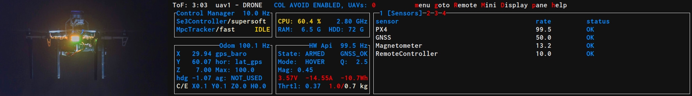
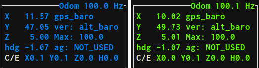
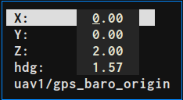
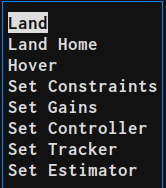
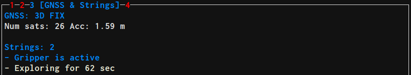
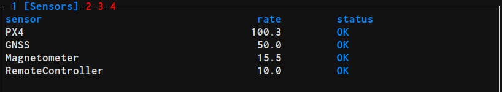

:::warning
This page is describing the upcoming ROS2 version of the MRS UAV System (however, it may be still outdated). If you are looking for ROS1 version of the docs, follow to https://ctu-mrs.github.io/docs/1.5.0/introduction/.
:::

# Status terminal user interface (TUI)



## Real-time Terminal User Interface for monitoring and control

* Displays useful information about the UAV state and sensors
* Provides a basic control interface through which you can move the UAV, monitor your nodes and switch trackers, controllers, estimators gains and constraints
* Especially useful in real world UAV flights, but works as well in simulation
* Written in C++ with ncurses
* Runs on the UAV within its TMUX session
* Works through SSH on a flying UAV
* Shows the data of the [DiagnosticsManager](../01-managers/index.md#diagnosticsmanager), which runs on the UAV as part of the core
* vim-like key bindings

### Starting the TUI

The example tmux sessions start it in the `status` window:

```bash
ros2 run mrs_uav_status status.sh
```

`status.sh` accepts these arguments:

* `custom_config:=<path>`: a custom config (absolute or relative to the current directory), the parameters are under `mrs_uav_status:`, see the [default config](https://github.com/ctu-mrs/mrs_uav_status/blob/ros2/config/public/default.yaml)
* `lightmode:=true|false`: the colour scheme for a light or a dark terminal

### Why is my mrs_uav_status blue?

* By default, mrs_uav_status runs in color-blind mode, where green color is replaced with blue. This helps with visibility if you have red-green color blindness.
* You can disable the color-blind mode with `mrs_uav_status/display/colorblind_mode: false` in the custom config of mrs_uav_status

 

### Controlling the UAV through MRS UAV Status

If the MRS UAV Status window is focused, you can use it to command the UAV. This works in simulation and with a real UAV through SSH.

 * press the 'R' key to enter the "remote" mode. While in this mode, you can fly the UAV with your keyboard:
   * use 'wsad' or 'hjkl' keys to fly laterally
   * use 'qe' keys to change the UAVs heading
   * use 'rf' keys to fly up and down
   * use 'G' to switch between local and global mode, in local mode, the UAV follows the commands in its FCU frame, in global mode the commands are interpreted in the current world frame (X and Y are independent of the UAV's heading)
   * Only one key at a time is registered, multiple key inputs are not supported
   * To exit the remote mode, hit 'Esc'

 

 * Press the 'g' key (as go-to) to set references for the UAV

 

 * Press the 'm' key (as menu) to call basic MRS System services.
   * If the UAV is flying, you can call the 'land' or 'land_home' service
   * If the UAV is on the ground, you can call the 'takeoff' service
   * You can change the controller, tracker, estimator, controller gains and tracker constraints

 

### Display custom messages from your nodes

If you need to monitor some aspect or behaviour of your node, you can display messages from said node in MRS UAV Status.
Simply publish a [std_msgs/String](https://docs.ros.org/en/jazzy/p/std_msgs/msg/String.html) message to the `/$UAV_NAME/uav_status/display_string` topic, and the message will show in MRS UAV Status (press 'p' to cycle the top-right pane to the strings).

```bash
ros2 topic pub /uav1/uav_status/display_string std_msgs/msg/String "data: 'Hello'"
```

 

 * By default, only one message is displayed: a new message replaces the previous one.
 * By default, the message will be displayed for 10 seconds
 * You can use several parameters with mrs_uav_status. These parameters are placed at the beginning of the string message, like this:
    * ```-id my_id -R -p the rest of my message```
 * -id my_id
    * If you want to display more messages at once, give each of them an id with the argument -id my_id
    * At the beginning of your string, put "-id my_id the rest of my message"
    * Message will be displayed for each unique id
* -p
    * You can add "-p " at the beginning of your string, to make the message persistent, it will not disappear, only if it is overridden by a new message
* -r, -y,- g, -R, -Y -G
    * By default, the messages will be displayed as black/white (depending on the current color scheme). You can use -r -y -g parameters to set the color to red/yellow/green. If you use
      capital letter as the parameter, it will make the displayed message blink

### Monitoring ROS topic rates

MRS UAV Status shows the sensor status reported by the [DiagnosticsManager](../01-managers/index.md#diagnosticsmanager) (press 'p' to cycle the top-right pane to the sensors), including a warning if a sensor topic is published less or more frequently than required, or not published at all.
The monitored sensors and their expected rates are configured in the DiagnosticsManager's sensor handlers, not in MRS UAV Status.

 

### Replay status in terminal from a bag file

MRS UAV Status shows the `diagnostics_manager/*` topics, so record them in the bag.
When replaying the bag, start MRS UAV Status with `ros2 run mrs_uav_status status.sh`.
