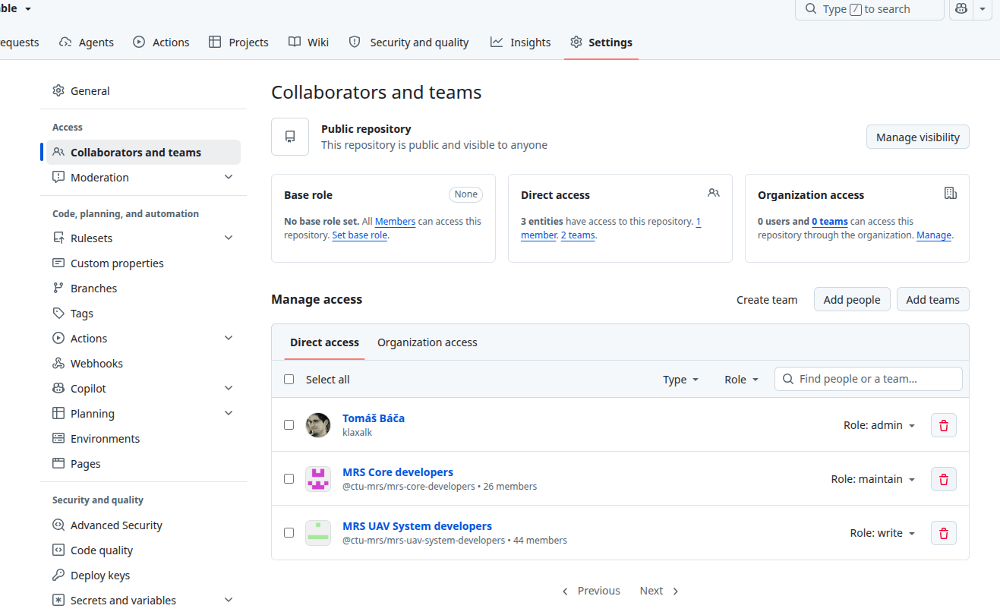
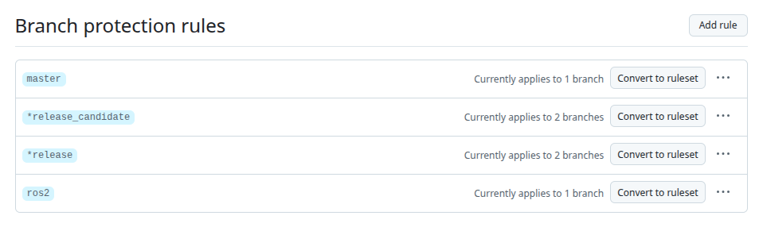
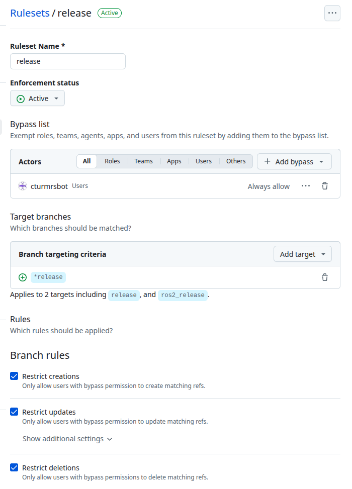
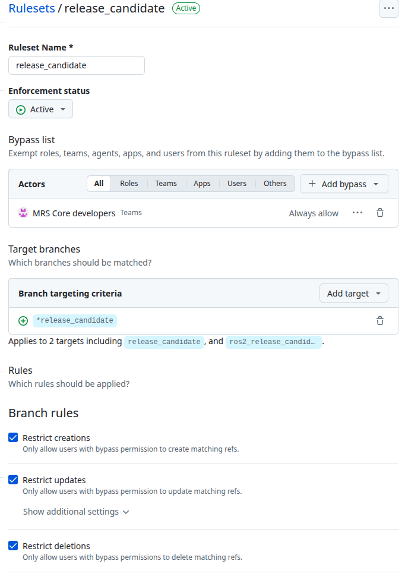
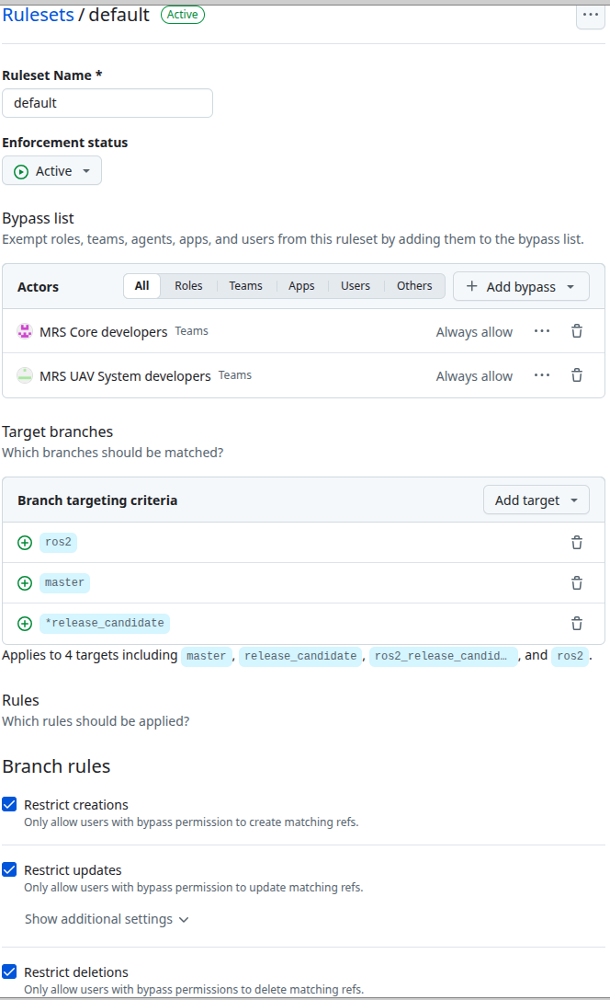
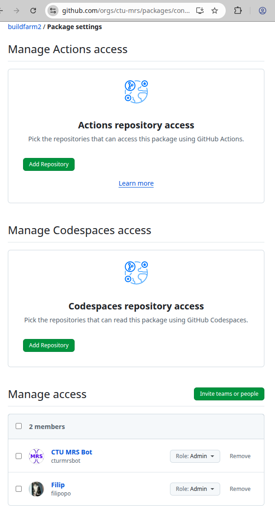

# MRS ROS Build Pipeline & CI/CD

:::warning
This section covers the continuous integration and deployment architecture for both ROS 2 (Jazzy) and ROS 1 (Noetic). If you are looking for the ROS 1 system documentation, see [MRS 1.5.0 Introduction](https://ctu-mrs.github.io/docs/1.5.0/introduction/).
:::

This guide provides a comprehensive overview of the **MRS Continuous Integration and Continuous Deployment (CI/CD) ecosystem**, explaining how individual package repositories, reusable GitHub workflows, central buildfarms, and Ubuntu Personal Package Archives (PPAs) interact to automatically compile, test, and distribute Debian packages for both **ROS 1 (Noetic)** and **ROS 2 (Jazzy)** across **amd64** and **arm64** architectures.

---

## 1. Ecosystem Architecture & Inter-relationships

The MRS software distribution relies on several loosely coupled components:

```
+-----------------------------------------------------------------------------------------+
|                                Individual Repositories                                  |
| (e.g., mrs_uav_managers, mrs_lib, mrs_robofly_core)                                     |
|  - Development Branches: ros2 / ros1 (legacy: master)                                   |
|  - Candidate Branches:   ros2_release_candidate / ros1_release_candidate                |
|  - Release Branches:     ros2_release / ros1_release                                    |
|  - Local Workflows:      .github/workflows/ros_package_build.yml, ros_build_test.yml    |
+-----------------------------------------------------------------------------------------+
                                      |
                                      v calls reusable workflows
+-----------------------------------------------------------------------------------------+
|                                ctu-mrs/ci_scripts                                       |
|  - Reusable GitHub Actions workflows (@ros2, @master)                                   |
|  - Bloom debian generation, architecture matrix builds (amd64, native/QEMU arm64)       |
|  - PPA deployment scripts (push_to_ppa.sh)                                              |
+-----------------------------------------------------------------------------------------+
                                      |
                                      v orchestrated & scheduled by
+-----------------------------------------------------------------------------------------+
|                    ctu-mrs/buildfarm (ROS 1) & ctu-mrs/buildfarm2 (ROS 2)               |
|  - Package registries: mrs.yaml, nonbloom.yaml, thirdparty.yaml                         |
|  - Dependency graph resolution & topological build order                                |
|  - Overnight matrix builders & automated test dispatchers                               |
+-----------------------------------------------------------------------------------------+
                                      |
                                      v builds inside primed container images
+-----------------------------------------------------------------------------------------+
|                     GitHub Container Registry (ghcr.io/ctu-mrs/...)                     |
|  - Builder images with pre-cached toolchains & dependencies                             |
+-----------------------------------------------------------------------------------------+
                                      |
                                      v publishes packages to
+-----------------------------------------------------------------------------------------+
|                                  Ubuntu PPAs                                            |
|  - ppa:ctu-mrs/ppa-unstable  <-- Automatic on-push from ros2 / ros1 (or master)         |
|  - ppa:ctu-mrs/ppa-testing   <-- Automatic on-push from *release_candidate              |
|  - ppa:ctu-mrs/ppa-stable    <-- Promoted by ctumrsbot upon passing automated tests     |
+-----------------------------------------------------------------------------------------+
```

### Individual Package Repositories
Every repository contains its own source code, `package.xml`, and `CMakeLists.txt`. Rather than re-implementing complex packaging scripts in every repository, each repo contains lightweight GitHub workflow files under `.github/workflows/` that delegate build tasks to centralized workflows in `ctu-mrs/ci_scripts`.

### `ctu-mrs/ci_scripts`

<Button label="🔗 ctu-mrs/ci_scripts repository" link="https://github.com/ctu-mrs/ci_scripts" block /><br />
The `ci_scripts` repository centralizes all packaging and deployment scripts:
- Standard ROS Bloom packaging (`bloom-generate rosdebian`)
- Non-bloom packaging for custom CMake, Autotools, or Make-based libraries
- Multi-architecture builds (native `amd64` and ARM64 via native runners or QEMU)
- PPA artifact publishing, GPG signing, and changelog updates via `push_to_ppa.sh`

### `ctu-mrs/buildfarm` (ROS 1) & `ctu-mrs/buildfarm2` (ROS 2)

<Button label="🔗 ctu-mrs/buildfarm repository" link="https://github.com/ctu-mrs/buildfarm" block />
<Button label="🔗 ctu-mrs/buildfarm2 repository" link="https://github.com/ctu-mrs/buildfarm2" block /><br />

The buildfarm repositories orchestrate complete automated builds of the entire MRS ecosystem. The pipeline is structured into three distinct sub-pipelines:

- **NonBloom packages** ([`nonbloom.yaml`](https://github.com/ctu-mrs/buildfarm/blob/master/nonbloom.yaml)): Packages not built with ROS Bloom; they rely on a generic Debian packaging mechanism for external C/C++ libraries and drivers.
- **Third-party ROS packages** ([`thirdparty.yaml`](https://github.com/ctu-mrs/buildfarm/blob/master/thirdparty.yaml)): External ROS dependencies packaged for MRS. They do not change often and do not depend on custom MRS packages.
- **MRS packages** ([`mrs.yaml`](https://github.com/ctu-mrs/buildfarm/blob/master/mrs.yaml)): The primary MRS UAV packages that form the core autonomous system. They depend on foundation libraries and third-party packages.

The ROS-driven pipelines automatically resolve the dependency graph into topological build orders so that upstream foundations (such as `mrs_msgs` and `mrs_lib`) compile and publish before downstream managers and controllers.


### Primed Builder Container Images (GHCR)
To avoid spending hours re-installing hundreds of Debian build dependencies on every workflow run, the buildfarm relies on pre-built builder images on GitHub Container Registry (GHCR):
- `ghcr.io/ctu-mrs/buildfarm2:jazzy_builder_amd_<sha>`
- `ghcr.io/ctu-mrs/buildfarm2:jazzy_builder_arm_<sha>`

---

## 2. The Three-Tier Distribution Model

MRS packages are distributed through three Launchpad PPAs corresponding to specific branch roles:

| Pipeline Tier | Target PPA | ROS 2 Standard Branch | ROS 1 Modern Branch | ROS 1 Legacy Branch | Purpose & Audience |
| :--- | :--- | :--- | :--- | :--- | :--- |
| **Unstable** | [`ppa:ctu-mrs/ppa-unstable`](https://github.com/ctu-mrs/ppa-unstable) | `ros2` | `ros1` | `master` | Active development; continuous on-push builds of the latest commits |
| **Testing** | [`ppa:ctu-mrs/ppa-testing`](https://github.com/ctu-mrs/ppa-testing) | `ros2_release_candidate` | `ros1_release_candidate` | `release_candidate` | Pre-release staging; daily validation and automated system testing |
| **Stable** | [`ppa:ctu-mrs/ppa-stable`](https://github.com/ctu-mrs/ppa-stable) | `ros2_release` | `ros1_release` | `release` | Verified production releases; physical drones and end users |

### Clarifying Branch Names (`master` vs `ros1` vs `ros2`)

Historically in ROS 1, repositories used `master`, `release_candidate`, and `release`. However, having generic `master` or `main` branches causes substantial confusion—especially in newer repositories where a `master` or `main` branch might exist as a default repository branch with **no ROS 1 / Noetic content whatsoever**.

To eliminate ambiguity, the clean standard across the MRS organization is:
- **ROS 2 Standard**: `ros2`, `ros2_release_candidate`, and `ros2_release`
- **ROS 1 Standard (Clean)**: `ros1`, `ros1_release_candidate`, and `ros1_release` (migrating away from generic `master`, `release_candidate`, and `release`)
- **Wildcard Ruleset Synergy**: Using wildcard patterns like `*release` and `*release_candidate` in GitHub rulesets cleanly protects both modern prefixed branches (`ros2_release`, `ros1_release`) and legacy branches (`release`) simultaneously without duplicate rules.

### Migrating Legacy ROS 1 Repositories (`master` &rarr; `ros1`)

To transition an existing ROS 1 repository from legacy `master` naming to the clean `ros1` convention without disrupting ongoing builds:

1. **Create the `ros1*` branches tracking existing branches**:
   ```bash
   git checkout -b ros1 origin/master
   git checkout -b ros1_release_candidate origin/release_candidate
   git checkout -b ros1_release origin/release
   git push -u origin ros1 ros1_release_candidate ros1_release
   ```

2. **Update workflow triggers to target `ros1`**:
   Update `.github/workflows/ros_package_build.yml` and `.github/workflows/ros_build_test.yml` on the `ros1` branch to trigger directly on `ros1`:
   ```yaml
   # ros_package_build.yml
   on:
     push:
       branches: [ ros1 ]
   ```
   ```yaml
   # ros_build_test.yml
   on:
     pull_request:
       branches: [ ros1 ]
   ```

3. **Update `buildfarm/mrs.yaml`**:
   Update the package entry in `buildfarm/mrs.yaml` so `git_refs` targets the new `ros1` branch family:
   ```yaml
   git_refs:
     unstable: ros1
     testing: ros1_release_candidate
     stable: ros1_release
   ```

4. **Rulesets apply automatically**:
   Because wildcard rulesets match `*release` and `*release_candidate`, both old and new branches stay strictly protected without needing to duplicate GitHub rules.

---

## 3. Why Are There Two Release Branches? (`*release_candidate` vs `*release`)

A central question often asked by developers is why both a candidate branch and a release branch are needed.

```
[Developer pushes / merges tested feature]
                    |
                    v
          *release_candidate
                    |
                    v (Builds packages)
             ppa-testing PPA
                    |
                    v (Runs overnight / on dispatch)
             Automated Tests (rostests)
                    |
             +------+------+
             |             |
           Passed        Failed
             |             |
             v             v
      [ctumrsbot merges]  [Release blocked!]
      *release_candidate   Fix issue in dev branch
        into *release      and re-promote
             |
             v (Builds packages)
             ppa-stable PPA
```

1. **Human Decision vs Automated Verification**:
   - Developers choose when a milestone or feature set is ready by pushing to `*release_candidate`.
   - The package is immediately built into the **testing PPA**.
2. **The Test Gatekeeper**:
   - Automated system integration tests (`rostest`) run against the testing PPA via the [release pipeline workflow](https://github.com/ctu-mrs/buildfarm/actions/workflows/rostest_and_release_mrs_amd64.yml).
   - If (and only if) all tests pass, the automated bot (**`ctumrsbot`**) automatically fast-forwards/merges `*release_candidate` into `*release`.
   - The stable build triggers exclusively from `*release`, publishing verified packages to the **stable PPA**.
3. **Protecting Production**:
   - Every commit that lands on `*release` generates a stable release. If humans pushed directly to `*release` and introduced a compile failure or subtle regression, it would immediately break the production PPA for all users. The candidate branch acts as an essential buffer.

:::danger Critical Rule
**Never push directly to `*release` manually.**
Only the automated bot account (`ctumrsbot`) should write to `*release` branches upon automated test validation.
:::

---

## 4. Step-by-Step: Adding a New Package to the Pipeline

Follow these 5 steps to onboard any repository into the MRS build pipeline.

### Step 1: Create the Required Branches

Create the candidate and release branches from your development branch:

```bash
# For a ROS 2 package:
git checkout ros2
git branch ros2_release_candidate
git branch ros2_release
git push -u origin ros2_release_candidate
git push -u origin ros2_release

# For a ROS 1 package (using clean ros1 naming):
git checkout ros1  # or git checkout master
git branch ros1_release_candidate
git branch ros1_release
git push -u origin ros1_release_candidate
git push -u origin ros1_release
```

---

### Step 2: Add Collaborator Teams or Maintainers (Suggested Access Pattern)

Before configuring GitHub Rulesets, **collaborators or teams must have access to the repository**. GitHub rulesets cannot exempt actors from rules or add them to bypass lists unless they already have direct repository access.

:::note Access Roles as Guidelines
Team membership, responsibilities, and repository ownership naturally vary across packages. The team roles below reflect a **suggested convention and convenient starting point** for repositories in the `ctu-mrs` organization, rather than a rigid mandate. Repository owners are encouraged to adapt these suggestions—for instance, by substituting individual maintainers or custom teams depending on who actively maintains the package.
:::

1. Open your repository on GitHub.
2. Go to **Settings** &rarr; **Collaborators and teams**.
3. Under **Manage access**, consider granting access according to your project's needs:
   - **Suggested Maintainer Access (`Maintain` role)**:
     - *Example group*: **`MRS Core developers`** (`@ctu-mrs/mrs-core-developers`) or designated individual package maintainers.
     - *Purpose*: Responsible for repository settings, triage, and staging release candidates (`*release_candidate`).
   - **Suggested Contributor Access (`Write` role)**:
     - *Example group*: **`MRS UAV System developers`** (`@ctu-mrs/mrs-uav-system-developers`) or active package contributors.
     - *Purpose*: Day-to-day development on `ros2` or `ros1`, opening pull requests, and pushing feature branches.



---

### Step 3: Configure Branch Protection Rulesets

Modern GitHub uses **Rulesets** (located in **Settings** &rarr; **Rules** &rarr; **Rulesets**). Unlike legacy branch protection rules which required duplicating rules per branch, rulesets support wildcard pattern matching across multiple targets.



We recommend setting up **two rulesets**:

#### Ruleset 1: `release` (Strict Bot Protection)
Protects all production release branches so only `ctumrsbot` can update them:
- **Ruleset Name**: `release`
- **Enforcement status**: `Active`
- **Bypass list**:
  - Add **`ctumrsbot`** (User) &rarr; Set to **Always allow**.
- **Target branches**:
  - Add target &rarr; **Include by pattern** &rarr; `*release`
  - *(Automatically matches `ros2_release`, `ros1_release`, and legacy `release`)*.
- **Branch rules**:
  - &check; **Restrict creations**
  - &check; **Restrict updates**
  - &check; **Restrict deletions**
  - &check; **Block force pushes** (checked by default)



#### Ruleset 2: `release_candidate` (Restricted to Maintainers)
Restricts candidate promotions so only authorized package maintainers can stage releases:
- **Ruleset Name**: `release_candidate`
- **Enforcement status**: `Active`
- **Bypass list**:
  - Add your designated maintainers (e.g. the **`MRS Core developers`** team, or individual package leads) &rarr; Set to **Always allow**.
- **Target branches**:
  - Add target &rarr; **Include by pattern** &rarr; `*release_candidate`
  - *(Automatically matches `ros2_release_candidate`, `ros1_release_candidate`, and legacy `release_candidate`)*.
- **Branch rules**:
  - &check; **Restrict creations**
  - &check; **Restrict updates**
  - &check; **Restrict deletions**
  - &check; **Block force pushes**



:::tip Recommended Simplified 2-Ruleset Alternative
You can also protect development branches and candidate branches together in a single **`default`** ruleset:
- **Ruleset 1 (`release`)**: Target `*release`, bypass for **`ctumrsbot` only**.
- **Ruleset 2 (`default`)**: Target `ros2`, `master`, `ros1`, and `*release_candidate`, granting bypass to your designated maintainers and contributors (e.g., `MRS Core developers` and `MRS UAV System developers`, or your repository's maintainer list).


:::

---

### Step 4: Add GitHub Actions Workflows to the Repository

Create two workflow files in `.github/workflows/` of the repository:

#### 1. `.github/workflows/ros_package_build.yml`
Builds and uploads Debian packages on push:

```yaml
name: ros_package_build

on:
  push:
    branches: [ ros2 ] # or [ ros1 ] for ROS 1
    paths-ignore:
      - '**/README.md'

  workflow_dispatch:

concurrency:
  group: ${{ github.workflow }}-${{ github.ref }}
  cancel-in-progress: true

jobs:
  build:
    uses: ctu-mrs/ci_scripts/.github/workflows/ros_package_build.yml@ros2 # or @master for ROS 1
    secrets:
      PUSH_TOKEN: ${{ secrets.PUSH_TOKEN }}
```

#### 2. `.github/workflows/ros_build_test.yml`
Tests pull requests and development branches without deploying to PPAs:

```yaml
name: ros_build_test

on:
  push:
    branches: [ ros2_devel ] # or [ devel, ros1_devel ]
    paths-ignore:
      - '**/README.md'

  pull_request:
    branches: [ ros2 ] # or [ ros1 ] for ROS 1

  workflow_dispatch:

concurrency:
  group: ${{ github.workflow }}-${{ github.ref }}
  cancel-in-progress: true

jobs:
  build:
    uses: ctu-mrs/ci_scripts/.github/workflows/ros_build_test.yml@ros2 # or @master for ROS 1
```

---

### Step 5: Register the Package in the Buildfarm

Register the package in the buildfarm registry:
- **ROS 2**: Edit `buildfarm2/mrs.yaml`
- **ROS 1**: Edit `buildfarm/mrs.yaml`

#### Example Entry (`mrs.yaml`):
```yaml
mrs_robofly_core:
  architecture: [amd64, arm64]
  source: https://github.com/ctu-mrs/mrs_robofly_core
  gitman: false
  git_refs:
    unstable: ros2                     # or ros1 (migrating from master)
    testing: ros2_release_candidate    # or ros1_release_candidate (from release_candidate)
    stable: ros2_release               # or ros1_release (from release)
  generate_apt_package: true
  generate_docker_image: false
  nix: false
  ros_test:
    enabled: false
    full_test_coverage: false
```

#### Field Explanations:
- **`architecture`**: Architecture targets: `[amd64, arm64]`.
- **`source`**: The HTTPS git clone URL.
- **`gitman`**: Set `true` if compilation depends on a `.gitman.yaml` configuration.
- **`git_refs`**: Branch names for `unstable`, `testing`, and `stable`.
- **`generate_apt_package`**: Set `true` to build binary and source Debian packages for the PPAs.
- **`generate_docker_image`**: Set `true` if the package generates a standalone Docker container image.
- **`nix`**: Whether to generate Nix derivations.
- **`ros_test`**:
  - `enabled`: `true` to run automated unit/integration tests during buildfarm runs.
  - `full_test_coverage`: Enables test coverage metrics.

---

## 5. Container Registry (GHCR) Access & Troubleshooting

The buildfarm executes builds inside primed Docker containers hosted on the GitHub Container Registry.

### The "Error response from daemon: denied" Issue

If you or a developer attempt to pull a builder image locally:
```bash
$ docker pull ghcr.io/ctu-mrs/buildfarm2:jazzy_builder_amd_36126839068
Error response from daemon: denied
```



### Why It Happens & How to Fix It
GitHub Packages images belong to the organization and are private by default:
1. **Actions Access**: In the package settings (`github.com/orgs/ctu-mrs/packages/container/<package_name>/settings`), the organization admin must ensure repositories running CI workflows are added under **Actions repository access**.
2. **Member Access**: Under **Manage access**, team members or developer groups must be granted **Read** access.
3. **Local Docker Authentication**: If pulling to a local machine, log in via a GitHub Personal Access Token (PAT) with `read:packages` scope:
   ```bash
   echo $GITHUB_PAT | docker login ghcr.io -u YOUR_GITHUB_USERNAME --password-stdin
   ```

---

## 6. Quick Reference Summary

| Task | Where to Configure | Who Has Access (Suggested Pattern) |
| :--- | :--- | :--- |
| Daily Development | Push to `ros2` / `ros1` | Package Contributors (suggested: `Write` access) |
| Propose Release | Push/Merge to `*release_candidate` | Package Maintainers (suggested: `Maintain` access) |
| Stable Deployment | Fast-forward to `*release` | **`ctumrsbot` only** (automated upon passing tests) |
| Collaborator Teams | Package Repo &rarr; Settings &rarr; Collaborators | Repository Admins |
| Branch Rulesets | Package Repo &rarr; Settings &rarr; Rules &rarr; Rulesets | Repository Admins |
| Register Package | `buildfarm2/mrs.yaml` or `buildfarm/mrs.yaml` | Buildfarm Maintainers |
| Builder Image Access | GitHub Org &rarr; Packages &rarr; Package Settings | Organization Admins |

:::note Note on Team Roles
Collaborator teams and access levels listed above are recommended guidelines. Repository owners may assign permissions to individual maintainers or alternative teams to best match who is actively developing and maintaining the codebase.
:::
